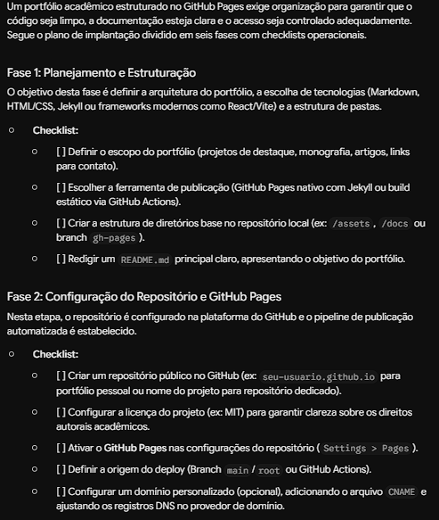
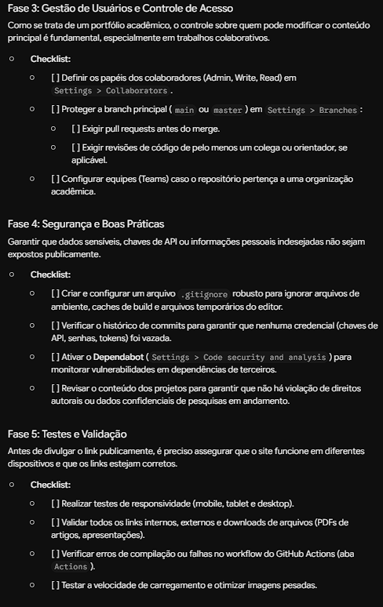
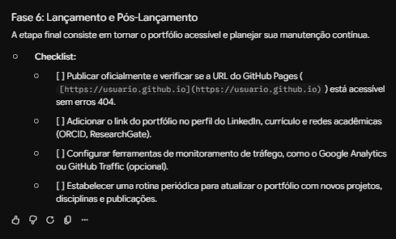
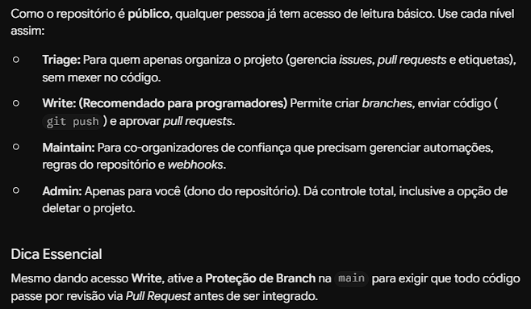
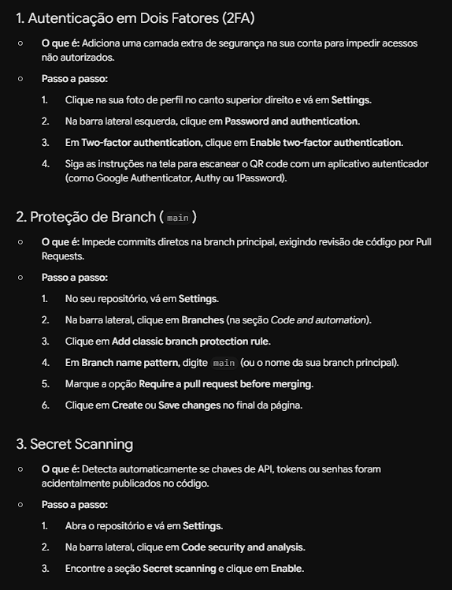
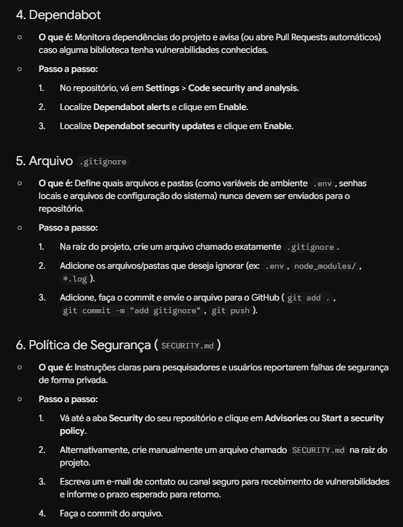
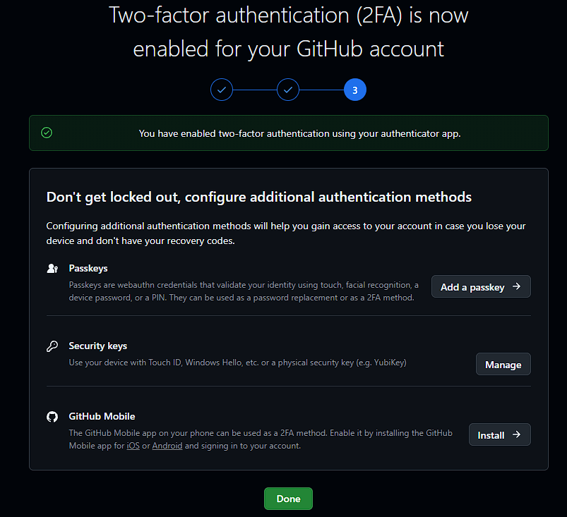
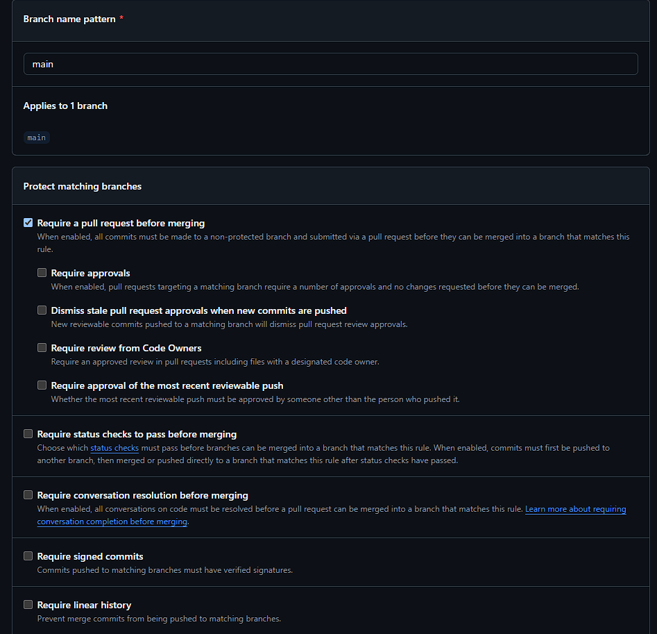

# Uso do Google Gemini na implantação

O Gemini foi usado como guia nas etapas abaixo. Para cada uma, registre o prompt que você enviou, um resumo do que ele respondeu, o que você aplicou e o print da conversa.

## 1. Plano de implantação

**Prompt enviado:**
> Estou implantando um portfólio de projetos acadêmicos em um repositório do GitHub com GitHub Pages. Crie um plano de implantação em fases, com checklist, cobrindo planejamento, configuração do GitHub, gestão de usuários, segurança, controle de acesso, testes e lançamento.

- **Resumo da resposta:** O Gemini propôs um plano em 6 fases, cada uma com checklist: Planejamento e Estruturação; Configuração do Repositório e GitHub Pages; Gestão de Usuários e Controle de Acesso; Segurança e Boas Práticas; Testes e Validação; e Lançamento e Pós-Lançamento. Entre os itens estão ativar o Pages, definir papéis de colaboradores, proteger a branch main com Pull Request, usar .gitignore e Dependabot, testar links e responsividade e divulgar no LinkedIn.
- **O que apliquei:** Usei o plano do Gemini como referência para organizar o projeto. Na fase de planejamento, defini a estrutura de pastas e escrevi o README principal. Na configuração, criei o repositório público no GitHub e publiquei a página pelo GitHub Pages usando a branch main. Na fase de testes, testei a página localmente e corrigi os links que davam erro 404. No lançamento, adicionei o projeto ao meu perfil do LinkedIn.
- **Print:**
  - 
  - 
  - 

## 2. Gestão de usuários

**Prompt enviado:**
> No GitHub, como devo configurar a gestão de usuários de um repositório pessoal público que terá poucos colaboradores? Explique os níveis de permissão (Read, Triage, Write, Maintain, Admin) e qual usar em cada caso.

- **Resumo da resposta:** O Gemini explicou que, como o repositório é público, qualquer pessoa já tem leitura básica. Recomendou Triage para quem só organiza issues e pull requests, Write para programadores que enviam código, Maintain para co-organizadores de confiança que gerenciam regras e automações, e Admin apenas para o dono. Também alertou que, mesmo com Write, é preciso ativar a proteção de branch na main para que todo código passe por revisão via Pull Request.
- **O que apliquei:** Como o projeto é individual, mantive minha conta como única Admin do repositório e não adicionei colaboradores. Registrei os níveis de permissão (Triage, Write, Maintain e Admin) e quando usar cada um, para aplicar caso o projeto passe a ter colaboradores. Também adotei a recomendação final do Gemini de proteger a branch main para exigir revisão via Pull Request, que será configurada na etapa de segurança.
- **Print:**
  - 

## 3. Políticas de segurança

**Prompt enviado:**
> Liste as melhores práticas de segurança para um repositório público no GitHub: autenticação em dois fatores, proteção de branch, secret scanning, Dependabot, .gitignore e política de segurança (SECURITY.md). Dê o passo a passo para ativar cada uma.

- **Resumo da resposta:** O Gemini apresentou o passo a passo de seis práticas: ativar a autenticação em dois fatores na conta; proteger a branch main exigindo Pull Request antes do merge; habilitar o Secret scanning para detectar chaves e senhas publicadas por engano; habilitar o Dependabot (alertas e atualizações de segurança) para dependências vulneráveis; criar um .gitignore para não enviar arquivos sensíveis como .env; e publicar um SECURITY.md com instruções para reportar falhas de segurança.
- **O que apliquei:** Criei o arquivo .gitignore, que impede o envio de arquivos sensíveis como .env, chaves e pastas de dependências, e o arquivo SECURITY.md, que explica como reportar falhas de segurança de forma privada. Os dois estão na raiz do repositório. Ativei a autenticação em dois fatores na conta do GitHub usando um aplicativo autenticador e guardei os códigos de recuperação em local seguro. Configurei a proteção da branch main, exigindo Pull Request antes de qualquer merge. Como o projeto é individual, não exigi aprovações de revisores. Ativei o Dependabot (alertas e atualizações de segurança) e o Secret scanning nas configurações de Code security do repositório.
- **Print:**
  - 
  - 
  - 
  - 

## 4. Compartilhamento e colaboração

**Prompt sugerido:**
> Como documentar o fluxo de colaboração em um repositório GitHub (branches, commits, Pull Requests e revisão)? Gere um modelo de CONTRIBUTING.md e de template de Pull Request.

- **Resumo da resposta:**
- **O que apliquei:**
- **Print:**

## 5. Testes antes do lançamento

**Prompt sugerido:**
> Crie um checklist de testes para publicar um site estático no GitHub Pages em produção: links, responsividade, acessibilidade, desempenho e segurança.

- **Resumo da resposta:**
- **O que apliquei:**
- **Print:**